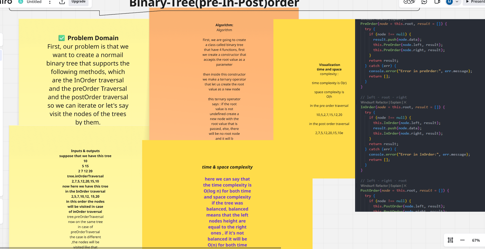
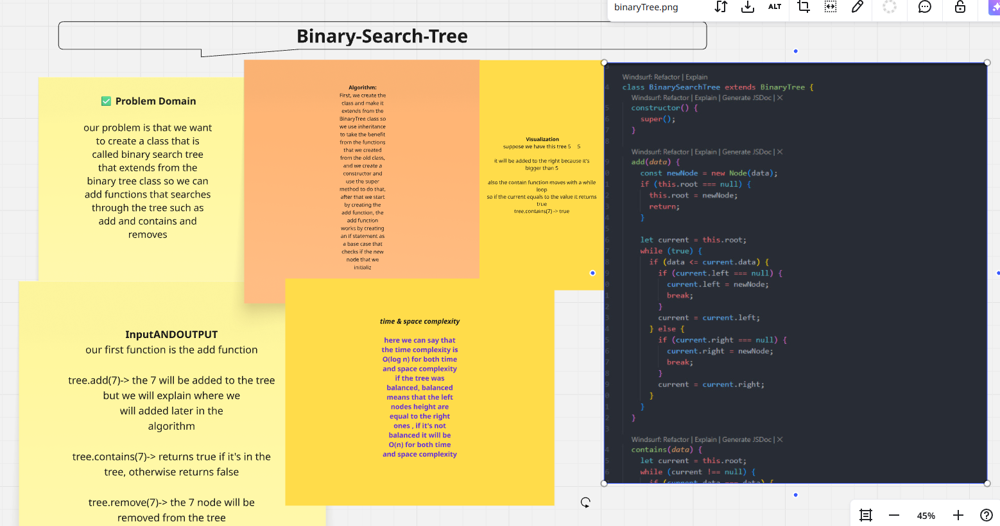
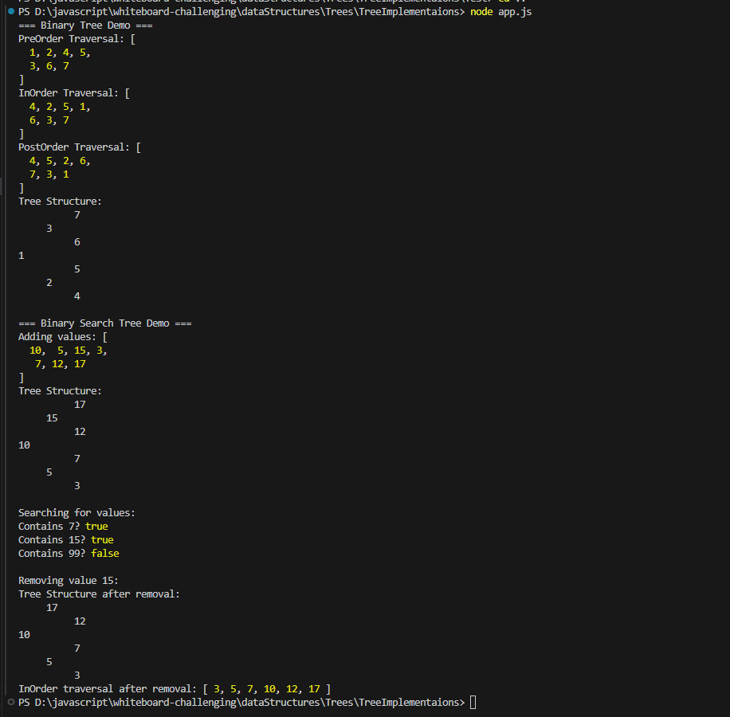
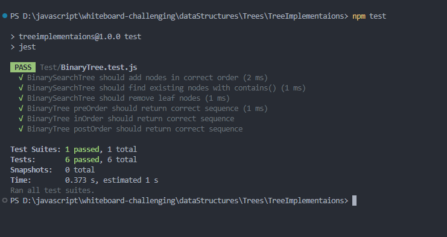

# Trees Implementations (Binary Tree & BST)

This folder contains simple JavaScript implementations for [BinaryTree](cci:2://file:///d:/javascript/whiteboard-challenging/dataStructures/Trees/TreeImplementaions/BinaryTree.js:3:0-62:1) traversals and a [BinarySearchTree](cci:2://file:///d:/javascript/whiteboard-challenging/dataStructures/Trees/TreeImplementaions/BinarySearchTree.js:4:0-91:1) with basic operations.

- Files:
  - [TNode.js](cci:7://file:///d:/javascript/whiteboard-challenging/dataStructures/Trees/TreeImplementaions/TNode.js:0:0-0:0) — Simple tree node (data, left, right)
  - [BinaryTree.js](cci:7://file:///d:/javascript/whiteboard-challenging/dataStructures/Trees/TreeImplementaions/BinaryTree.js:0:0-0:0) — Traversals: [PreOrder](cci:1://file:///d:/javascript/whiteboard-challenging/dataStructures/Trees/TreeImplementaions/BinaryTree.js:8:2-21:3), [InOrder](cci:1://file:///d:/javascript/whiteboard-challenging/dataStructures/Trees/TreeImplementaions/BinaryTree.js:23:2-36:3), [PostOrder](cci:1://file:///d:/javascript/whiteboard-challenging/dataStructures/Trees/TreeImplementaions/BinaryTree.js:38:2-51:3), and [printTree](cci:1://file:///d:/javascript/whiteboard-challenging/dataStructures/Trees/TreeImplementaions/BinaryTree.js:53:2-61:3)
  - [BinarySearchTree.js](cci:7://file:///d:/javascript/whiteboard-challenging/dataStructures/Trees/TreeImplementaions/BinarySearchTree.js:0:0-0:0) — Extends [BinaryTree](cci:2://file:///d:/javascript/whiteboard-challenging/dataStructures/Trees/TreeImplementaions/BinaryTree.js:3:0-62:1), adds [add](cci:1://file:///d:/javascript/whiteboard-challenging/dataStructures/Trees/TreeImplementaions/BinarySearchTree.js:9:2-32:3), [contains](cci:1://file:///d:/javascript/whiteboard-challenging/dataStructures/Trees/TreeImplementaions/BinarySearchTree.js:34:2-46:3), [remove](cci:1://file:///d:/javascript/whiteboard-challenging/dataStructures/Trees/TreeImplementaions/BinarySearchTree.js:48:2-54:3), [findMin](cci:1://file:///d:/javascript/whiteboard-challenging/dataStructures/Trees/TreeImplementaions/BinarySearchTree.js:85:2-90:3)
  - [Test/BinaryTree.test.js](cci:7://file:///d:/javascript/whiteboard-challenging/dataStructures/Trees/TreeImplementaions/Test/BinaryTree.test.js:0:0-0:0) — Jest tests for traversals and BST operations
  - [app.js](cci:7://file:///d:/javascript/whiteboard-challenging/dataStructures/Trees/TreeImplementaions/app.js:0:0-0:0) — Example usage

## Visuals

- Binary Tree (whiteboard)
  

- Binary Search Tree (whiteboard)
  

- Console Output Example
  

- Test Output
  

## API

### BinaryTree
- [PreOrder(node = this.root, result = [])](cci:1://file:///d:/javascript/whiteboard-challenging/dataStructures/Trees/TreeImplementaions/BinaryTree.js:8:2-21:3)  
  Order: root → left → right
- [InOrder(node = this.root, result = [])](cci:1://file:///d:/javascript/whiteboard-challenging/dataStructures/Trees/TreeImplementaions/BinaryTree.js:23:2-36:3)  
  Order: left → root → right
- [PostOrder(node = this.root, result = [])](cci:1://file:///d:/javascript/whiteboard-challenging/dataStructures/Trees/TreeImplementaions/BinaryTree.js:38:2-51:3)  
  Order: left → right → root
- [printTree(node = this.root, space = 0, levelSpace = 5)](cci:1://file:///d:/javascript/whiteboard-challenging/dataStructures/Trees/TreeImplementaions/BinaryTree.js:53:2-61:3)  
  Pretty prints the tree sideways to console.

### BinarySearchTree (extends BinaryTree)
- [add(data)](cci:1://file:///d:/javascript/whiteboard-challenging/dataStructures/Trees/TreeImplementaions/BinarySearchTree.js:9:2-32:3) — Inserts `data` keeping BST property (duplicates go to left)
- [contains(data)](cci:1://file:///d:/javascript/whiteboard-challenging/dataStructures/Trees/TreeImplementaions/BinarySearchTree.js:34:2-46:3) — Returns `true/false`
- [remove(data)](cci:1://file:///d:/javascript/whiteboard-challenging/dataStructures/Trees/TreeImplementaions/BinarySearchTree.js:48:2-54:3) — Removes a node by value (handles 0, 1, 2 children)
- [findMin(node)](cci:1://file:///d:/javascript/whiteboard-challenging/dataStructures/Trees/TreeImplementaions/BinarySearchTree.js:85:2-90:3) — Returns the minimum node starting at `node`

## Example

See [app.js](cci:7://file:///d:/javascript/whiteboard-challenging/dataStructures/Trees/TreeImplementaions/app.js:0:0-0:0) for a runnable example:
```js
const BinarySearchTree = require("./BinarySearchTree");
const bst = new BinarySearchTree();
[10,5,15,3,7].forEach(v => bst.add(v));
console.log("InOrder:", bst.InOrder()); // [3,5,7,10,15]
console.log("Has 7?", bst.contains(7)); // true
bst.remove(5);
console.log("After remove 5:", bst.InOrder()); // [3,7,10,15]
bst.printTree();